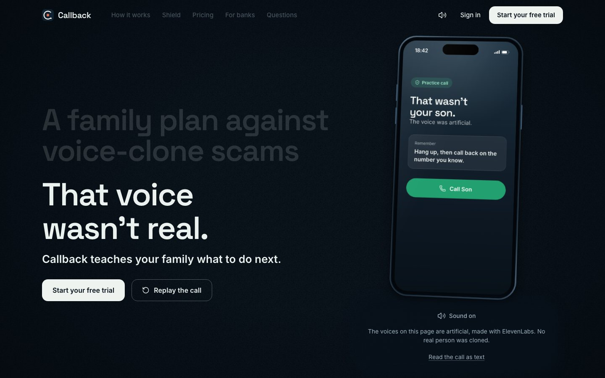
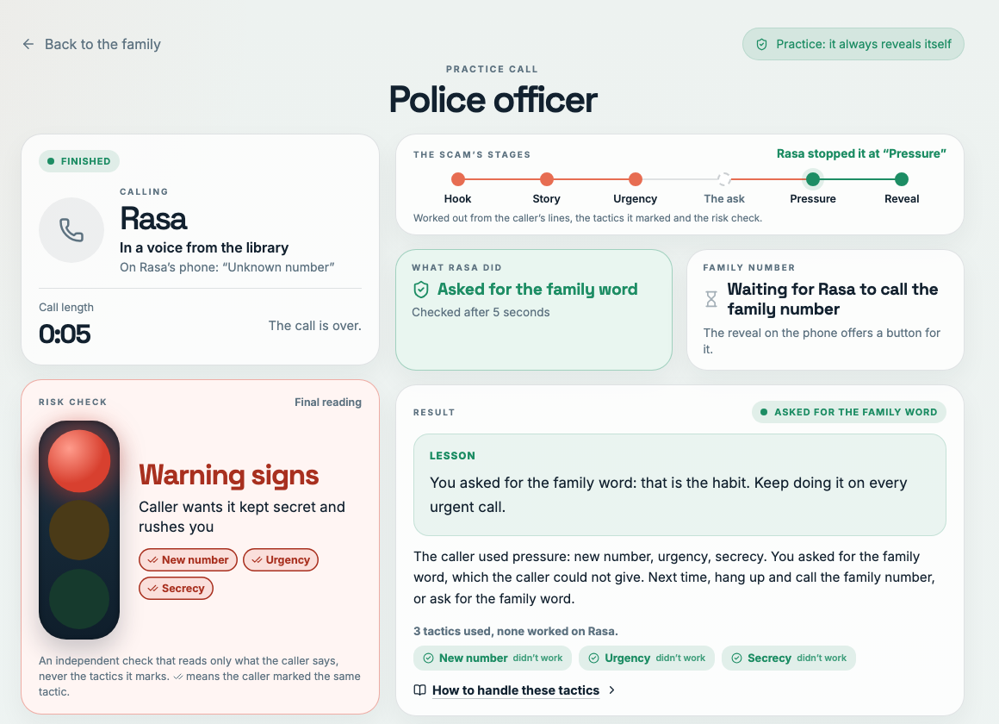
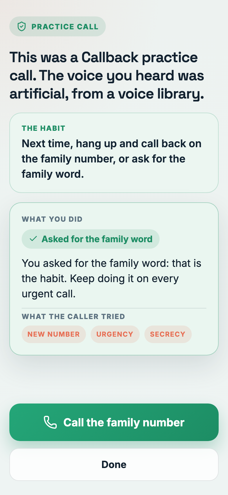
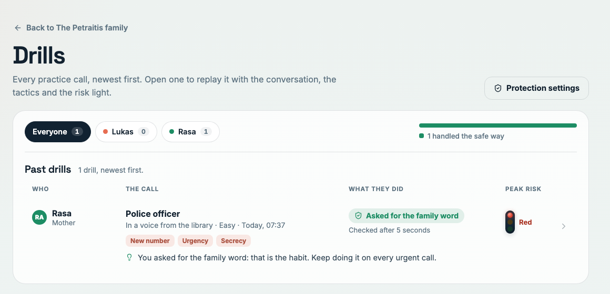
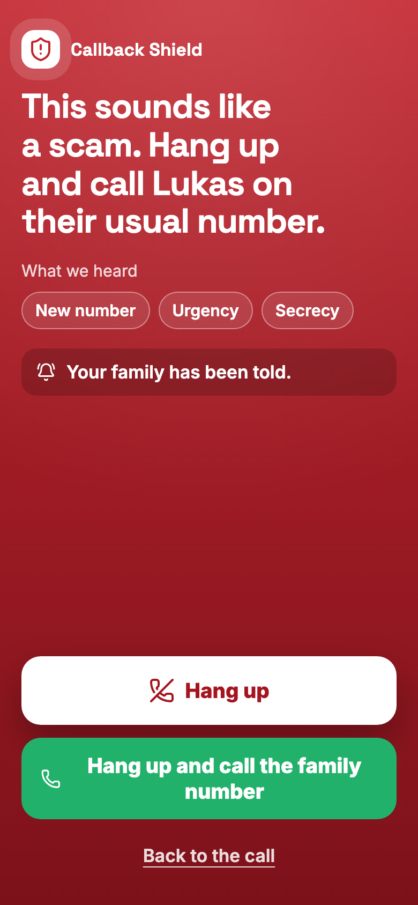
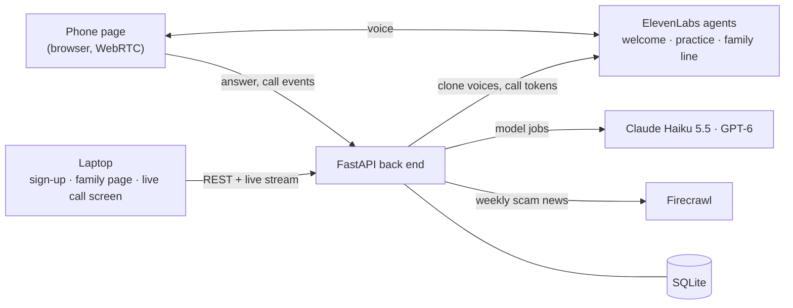

# Callback

**A family plan against voice-clone scams.** Callback phones your parents in a relative's cloned voice, with everyone's consent, plays out a scam, and reveals itself at the end. Over a few short practice calls the family learns one habit: **hang up and call back**, or ask for the family word. During a call that sounds like a real scam, **Callback Shield** warns the person on screen and alerts the family.

Live: **https://callback.denishoti.dev** (landing page, [pricing](https://callback.denishoti.dev/pricing), [for banks](https://callback.denishoti.dev/#banks)) · Built at Unfair Weekend 2026, Vilnius, by team Plan C.

---

## The problem

A few seconds of someone's voice is enough to clone it. Scammers now call parents and grandparents in their child's voice: "Mum, it's me, I lost my phone, I need money today." The voice is right, the panic is real, and spam filters and caller ID don't help when the number is "new".

Detection is an arms race: every new cloning model resets the detector. A habit doesn't expire. If your mother hangs up and calls you back on the number she knows, it doesn't matter how good the clone was.

## What Callback does

<p>
  
</p>

1. **Sign-up.** The organiser registers and adds the family: who's in it, each person's own consent to practice calls, and whether the family has agreed a family word, as a yes or no. The word itself is never asked for. Each relative then gets their own invite link (a QR code, Copy or Share).
2. **Joining and the welcome call.** Each person opens their link on their own phone and ticks two consents: practice calls without knowing when, and Callback copying their voice from their welcome call. Joining starts the welcome call by itself. The agent explains the plan and asks for consent to practice calls; then, as a separate question, "May Callback use your voice from this call to make practice calls to your family, in your voice?". It also learns who they would trust on the phone (the bank? the police? a grandchild?). Only after that second spoken yes is a voice clone made, from the person's own side of the call (their microphone only, at least about 10 seconds of speech; otherwise nothing is kept). Recording a voice sample at sign-up stays optional.
3. **Random drills.** Once the organiser turns protection on, practice calls ("drills") ring at random moments inside the family's hours, a few a week; nobody is told when. A voice agent plays a scam in a relative's cloned voice (or a "bank" or "police" voice from a library), using real pressure tactics in order: a new number, urgency, secrecy, an unusual payment.
4. **The reveal.** The moment the person asks for the family word, hangs up to call back, or agrees to pay, the agent stops, says it was a practice, and gives a one-line lesson. One tap calls the real family number.
5. **Review and the plan.** Each call is scored on what the person *did*, never on whether the voice fooled them. The organiser replays every drill with its transcript, tactics and risk light, sees who did what, and reads short lessons and the week's scam news. A planner picks the next practice against each person's weak spot.

On the organiser's laptop, the **live call screen** shows the conversation as it happens, each tactic labelled as the agent uses it, and a **traffic light**: an independent model reads only what the caller says and turns the light yellow, then red, as the scam builds.

<table>
  <tr>
    <td width="68%"></td>
    <td width="32%"></td>
  </tr>
  <tr>
    <td colspan="2"></td>
  </tr>
</table>

## Callback Shield



Practice builds the habit. Shield is there when a call that sounds like a scam is still going:

- **A warning on screen during the call.** As soon as the live risk check hears a scam (a red light, or a request for money or a code), the phone shows "This sounds like a scam. Hang up and call Lukas on their usual number.", with what it heard and a button to call the family number.
- **The family is alerted automatically,** once per call, with no tap from anyone (and a Web Push notification when push is set up).
- **A "Something's wrong" button** on the phone alerts the family at any time, call or no call.

Today Shield works on calls that come through Callback: the "Shield demo call" rings a simulated scam call through the app. Forwarding ordinary phone calls to a Callback line is next. Details: [docs/full-app/protection.md](docs/full-app/protection.md).

<br clear="right">

## Demo in two minutes

You need a laptop and a phone (or a second browser window). On the live site, or locally (see below):

1. **Register** at `/register` and add the family: you and Mum. Tick "We have agreed a family word" if you have one; never type the word.
2. **Open Mum's invite link** on the phone: scan her QR code, or Copy the link into the other window. (Signing up on your own phone? "Join on this phone" does the same for your own card.) Tick both consents and tap Join.
3. **Answer the welcome call** that rings by itself, and say yes to both questions.
4. On the family page, switch **Protection** on.
5. In **"Show it working"**, choose Mum and press **"Ring a surprise drill"**. Keep her phone page open: the drill rings within about a minute.
6. Answer it on the phone and press **"Watch the call"** on the laptop: the live screen with the tactics and the risk light.
7. Ask for the family word (or hang up): the phone shows the **reveal** and the one-tap call to the family number.
8. Open **Drills** to replay it with the transcript, the tactics and the risk light.
9. Then **"Start a Shield demo call"** to Mum. It rings at once; as soon as the caller asks for money, her phone shows the Shield warning and the family is alerted (Activity shows the alert).

## Safety by design

Practice calls only work if they are fair. These rules are enforced in code, not just promised:

- **Consent from both sides.** Each person ticks consent to practice calls and to copying their voice when they join, and confirms both out loud on the welcome call, as two separate questions. A voice is copied only from that person's own side of the call, and only after their spoken yes; without it the recording is deleted. A "no" to practice calls withdraws that consent, and no practice call can start without it.
- **Every call reveals itself.** The reveal line is fixed and spoken word for word, however the call ends.
- **No real harm.** No emergencies, injuries, arrests or kidnappings; no real bank or company names; the agent interrupts anyone starting to read out a number or code.
- **No secrets collected.** The family word is never asked for or stored, only whether the family has one.
- **Clones stay in the family** and are deleted on request or opt-out.
- **Scored on behaviour, not on being fooled.** No public list of who "failed".

## Business model

The prices are the ones on the [pricing page](https://callback.denishoti.dev/pricing):

- **Families:** €4.99 a month or €49 a year, after a 30-day free trial. Up to six family members; cancel any time.
- **Through a partner bank:** free for the family, with a code from the bank.
- **Banks** pay per enrolled family (the price is not set yet). Banks are being made liable for scam losses; Callback is the practice they can give their customers' families, with an anonymous count of families who practised. See [Callback for banks](https://callback.denishoti.dev/#banks).
- **This is a demo:** choosing a plan only records it. No payment is taken and no card details are asked for ([docs/full-app/billing.md](docs/full-app/billing.md)).

The landing page has a **family waitlist** (to hear when Callback rings real phones and speaks Lithuanian) and a **bank enquiry form**. Both post to `POST /api/waitlist` with `kind` `family` or `bank` ([docs/full-app/waitlist.md](docs/full-app/waitlist.md)).

## How it works



- **Voice: ElevenLabs Agents.** Three agents (welcome, practice, family line) run in the browser over WebRTC. The back end issues a short-lived token per call and switches the agent's voice to the relative's instant voice clone for that call only. The agents report what happens through client tools: `mark_tactic` when they start a pressure tactic, `practice_result` when the practice is decided, `consent_result` and `voice_consent_result` in the welcome call.
- **The back end** (FastAPI, SQLAlchemy, SQLite) owns every rule: the consent gate, the reveal, scoring, readiness, plans, random drills, the Shield and the live stream to the laptop. The phone page polls once a second; the laptop gets server-sent events.
- **Model jobs: numbers from code, words from models.** Seven small jobs, each with a time limit, a second model at the other provider, and a fallback in code, so the demo never stalls:

  | Job | What it does | Model |
  |---|---|---|
  | Profiler | Reads the welcome call: whom they trust, their weak spot, a quote | GPT-6 Astra |
  | Director | Tailors the practice story to that weak spot | Claude Haiku 5.5 |
  | Scorer | Labels what the person did and writes the one-line lesson | Claude Haiku 5.5 |
  | Live risk check | Reads the caller's words during the call; code turns its signals into green, yellow, red | Claude Haiku 5.5 |
  | Planner | Picks the next practices for each person | GPT-6 Astra |
  | Digest and weekly note | A current scam pattern from consumer-protection news (via Firecrawl), and a short note per person | GPT-6 Astra, Claude Haiku 5.5 |

## The hard parts, and how we checked them

- **A real conversation in a cloned voice, set per call, in the browser.** The three agents are created and configured from code (`backend/voice_agents/sync.py`), and scripted conversations run against the real agents on ElevenLabs (`voice_agents/agent_tests.py`): asking for the family word, hanging up to call back, agreeing to pay, and a yes and a no in the welcome call. On 13 Nov those five passed 5/5, with the right tool calls, the reveal word for word, and the agent hanging up. The welcome call has since gained the voice question; its updated scripts (six in all, see [voice_agents/README.md](backend/voice_agents/README.md)) have not been run against the real agents yet.
- **An independent live risk check.** It never sees the agent's own tactic labels, so its agreement with them is a fair test. On ten written practice transcripts with the real models, it agreed with the agent's tactics with 0.80 precision and 0.87 recall, ended 8 calls red and 2 yellow, and answered in about 1.2 s (2.4 s at the 95th percentile).
- **Scoring.** The scorer labels 9 of 10 test transcripts correctly.
- **Tests.** 1,080 back-end tests run offline in about two minutes (including tests written independently from the spec), and a live group (`pytest -m live`) checks the real ElevenLabs agents, voices and tokens, every model job against its time limit, Firecrawl, and a whole practice path with real models.

## Repository

| Folder | What's there |
|---|---|
| `frontend/` | React, Vite and TypeScript: the landing page (`/`) and `/pricing` (`src/pages/LandingPage/`), sign-up and joining, the family page, the live call screen, drill review, activity, learning and news, and the phone page |
| `backend/` | FastAPI app, model jobs and prompts (`app/agents/`), voice agents (`voice_agents/`), tests |
| `docs/` | The plan ([`idea.md`](docs/idea.md)), the back-end spec ([`backend.md`](docs/backend.md)), the AI design ([`ai.md`](docs/ai.md)), and the full-app specs in [`docs/full-app/`](docs/full-app/): [accounts, invites and joining](docs/full-app/track1.md), [voice from the welcome call](docs/full-app/voice-from-call.md), [protection and Shield](docs/full-app/protection.md), [review](docs/full-app/review.md), [billing](docs/full-app/billing.md), [waitlist](docs/full-app/waitlist.md) |
| `deploy/` | Server set-up and deploy scripts; CI in `.github/workflows/` |

## Running it locally

```bash
# back end (Python 3.12 and ffmpeg)
cd backend
python3 -m venv .venv && .venv/bin/pip install -r requirements.txt
cp .env.example .env          # add your keys (see the note on FAKE_ELEVENLABS below)
.venv/bin/uvicorn app.main:app --port 8000
.venv/bin/pytest -q           # the offline tests

# front end (Node 22), in another terminal
cd frontend
npm ci
npm run dev                   # http://localhost:5173, proxies /api to :8000
# or against the deployed back end: API_TARGET=https://callback.denishoti.dev npm run dev
```

Without keys, run the back end with `FAKE_ELEVENLABS=true`: the whole flow runs with fake call tokens and voices, so nothing is spent, but a call answered on the phone page does not reach a voice agent. To drive a full practice path in that mode, `backend/scripts/fake_phone.py` does it over HTTP and prints PASS or FAIL per step ([backend/README.md](backend/README.md)).

Phones need HTTPS for the microphone, so test calls on a phone through the deployed site. More detail: [backend/README.md](backend/README.md) and [deploy/README.md](deploy/README.md).

## What's next

- **Real phone calls.** This weekend the call rings in a web page on the phone; the product rings the real phone (the same agents work over a phone number), and Shield covers ordinary calls forwarded to a Callback line.
- **European languages**, starting with Lithuanian.
- **Banks as the buyer.** Banks are being made liable for scam losses; this is the practice they can give their customers' families. The offer is on the landing page: [Callback for banks](https://callback.denishoti.dev/#banks).

## Development tools

Project skills for Claude Code are stored in `.claude/skills/` and tracked by `skills-lock.json`: [Taste Skill](https://github.com/Leonxlnx/taste-skill) (`design-taste-frontend`, needs Node.js 22+ and Chrome, Edge or Chromium), [Impeccable](https://github.com/pbakaus/impeccable) (`impeccable`) and [Playwright CLI](https://github.com/microsoft/playwright-cli) (`playwright-cli`, install its CLI with `npm install -g @playwright/cli@latest`; needs Node.js 20+). Upstream license and notice files are kept alongside each skill.
