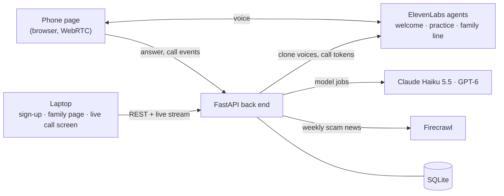

# Callback

**A family plan against voice-clone scams.** Callback phones your parents in a relative's cloned voice, with everyone's consent, plays out a scam, and reveals itself at the end. Over a few short practice calls the family learns one habit: **hang up and call back**, or ask for the family word.

Live: **https://callback.denishoti.dev** · Built at Unfair Weekend 2026, Vilnius, by team Plan C.

---

## The problem

A few seconds of someone's voice is enough to clone it. Scammers now call parents and grandparents in their child's voice: "Mum, it's me, I lost my phone, I need money today." The voice is right, the panic is real, and spam filters and caller ID don't help when the number is "new".

Detection is an arms race: every new cloning model resets the detector. A habit doesn't expire. If your mother hangs up and calls you back on the number she knows, it doesn't matter how good the clone was.

## What Callback does

1. **Sign-up.** An adult child adds the family: who's in it, whether they have agreed a family word (we never ask for the word itself), and each person's own consent to practice calls. Each relative records one minute of their voice, opening with a spoken consent sentence.
2. **Welcome call.** A voice agent calls each person, explains the plan, asks for spoken consent and learns who they would trust on the phone (the bank? the police? a grandchild?).
3. **Practice calls.** On a day they don't know in advance, the person's phone rings. A voice agent plays a scam in a relative's cloned voice (or a "bank" or "police" voice from a library), using real pressure tactics in order: a new number, urgency, secrecy, an unusual payment.
4. **The reveal.** The moment the person asks for the family word, hangs up to call back, or agrees to pay, the agent stops, says it was a practice, and gives a one-line lesson. One tap calls the real family number.
5. **The plan.** Each call is scored on what the person *did*, never on whether the voice fooled them. A planner picks the next practice against that person's weak spot, and the family page shows the habit growing.

On the organiser's laptop, the **live call screen** shows the conversation as it happens, each tactic labelled as the agent uses it, and a **traffic light**: an independent model reads only what the caller says and turns the light yellow, then red, as the scam builds.

## Safety by design

Practice calls only work if they are fair. These rules are enforced in code, not just promised:

- **Consent from both sides.** The person whose voice is cloned records spoken consent; the person called ticks consent at sign-up and confirms it in the welcome call. A "no" in the welcome call withdraws it, and no practice call can start without it.
- **Every call reveals itself.** The reveal line is fixed and spoken word for word, however the call ends.
- **No real harm.** No emergencies, injuries, arrests or kidnappings; no real bank or company names; the agent interrupts anyone starting to read out a number or code.
- **No secrets collected.** The family word is never asked for or stored, only whether the family has one.
- **Clones stay in the family** and are deleted on request or opt-out.
- **Scored on behaviour, not on being fooled.** No public list of who "failed".

## How it works



- **Voice: ElevenLabs Agents.** Three agents (welcome, practice, family line) run in the browser over WebRTC. The back end issues a short-lived token per call and switches the agent's voice to the relative's instant voice clone for that call only. The agents report what happens through client tools: `mark_tactic` when they start a pressure tactic, `practice_result` when the practice is decided, `consent_result` in the welcome call.
- **The back end** (FastAPI, SQLAlchemy, SQLite) owns every rule: the consent gate, the reveal, scoring, readiness, plans and the live stream to the laptop. The phone page polls once a second; the laptop gets server-sent events.
- **Model jobs: numbers from code, words from models.** Seven small jobs, each with a time limit, a second model at the other provider, and a fallback in code, so the demo never stalls:

  | Job | What it does | Model |
  |---|---|---|
  | Profiler | Reads the welcome call: whom they trust, their weak spot, a quote | GPT-6 Astra |
  | Director | Tailors the practice story to that weak spot | Claude Haiku 5.5 |
  | Scorer | Labels what the person did and writes the one-line lesson | Claude Haiku 5.5 |
  | Live risk check | Reads the caller's words during the call; code turns its signals into green, yellow, red | Claude Haiku 5.5 |
  | Planner | Picks the next practices for each person | GPT-6 Astra |
  | Digest and weekly note | A current scam pattern from consumer-protection news (via Firecrawl), and a short note per person | GPT-6 Astra, Claude Haiku 5.5 |

## The hard parts, and how we checked them

- **A real conversation in a cloned voice, set per call, in the browser.** The three agents are created and configured from code (`backend/voice_agents/sync.py`), and five scripted conversations run against the real agents on ElevenLabs (`voice_agents/agent_tests.py`): asking for the family word, hanging up to call back, agreeing to pay, and a yes and a no in the welcome call. 5/5 pass, with the right tool calls, the reveal word for word, and the agent hanging up.
- **An independent live risk check.** It never sees the agent's own tactic labels, so its agreement with them is a fair test. On ten written practice transcripts with the real models, it agreed with the agent's tactics with 0.80 precision and 0.87 recall, ended 8 calls red and 2 yellow, and answered in about 1.2 s (2.4 s at the 95th percentile).
- **Scoring.** The scorer labels 9 of 10 test transcripts correctly.
- **Tests.** 774 back-end tests run offline in about 100 s (including tests written independently from the spec), and a live group (`pytest -m live`) checks the real ElevenLabs agents, voices and tokens, every model job against its time limit, Firecrawl, and a whole practice path with real models.

## Repository

| Folder | What's there |
|---|---|
| `frontend/` | React, Vite and TypeScript: sign-up, the family page, the live call screen and the phone page |
| `backend/` | FastAPI app, model jobs and prompts (`app/agents/`), voice agents (`voice_agents/`), tests |
| `docs/` | The plan (`idea.md`), the back-end spec (`backend.md`) and the AI design (`ai.md`) |
| `deploy/` | Server set-up and deploy scripts; CI in `.github/workflows/` |

## Running it locally

```bash
# back end (Python 3.12 and ffmpeg)
cd backend
python3 -m venv .venv && .venv/bin/pip install -r requirements.txt
cp .env.example .env          # add your keys; or run with FAKE_ELEVENLABS=true to try it without voice
.venv/bin/uvicorn app.main:app --port 8000
.venv/bin/pytest -q           # the offline tests

# front end (Node 22), in another terminal
cd frontend
npm ci
npm run dev                   # http://localhost:5173, proxies /api to :8000
# or against the deployed back end: API_TARGET=https://callback.denishoti.dev npm run dev
```

Phones need HTTPS for the microphone, so test calls on a phone through the deployed site. More detail: [backend/README.md](backend/README.md) and [deploy/README.md](deploy/README.md).

## What's next

- **Real phone calls.** This weekend the call rings in a web page on the phone; the product rings the real phone (the same agents work over a phone number).
- **European languages**, starting with Lithuanian.
- **Banks as the buyer.** Banks are being made liable for scam losses; this is the practice they can give their customers' families.

## Development tools

Project skills for Claude Code are stored in `.claude/skills/` and tracked by `skills-lock.json`: [Taste Skill](https://github.com/Leonxlnx/taste-skill) (`design-taste-frontend`, needs Node.js 22+ and Chrome, Edge or Chromium), [Impeccable](https://github.com/pbakaus/impeccable) (`impeccable`) and [Playwright CLI](https://github.com/microsoft/playwright-cli) (`playwright-cli`, install its CLI with `npm install -g @playwright/cli@latest`; needs Node.js 20+). Upstream license and notice files are kept alongside each skill.
